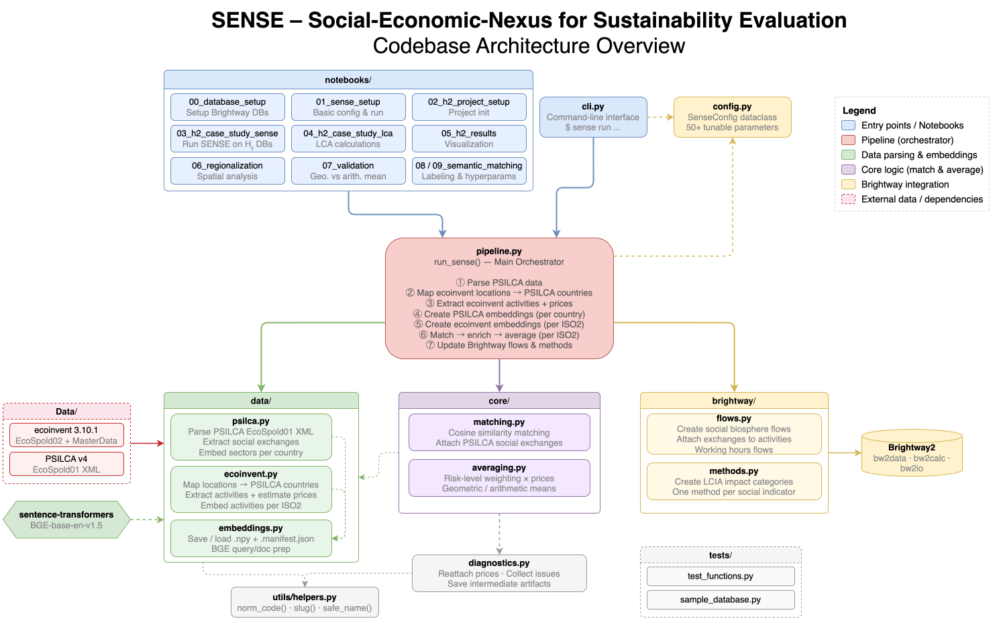

# SENSE: Social and Environmental Nexus for Sustainability Evaluation

<p align="center">
  
</p>

<p align="center">
  <a href="https://www.python.org/downloads/">
    
  </a>
  <a href="https://opensource.org/licenses/MIT">
    
  </a>
</p>

**SENSE** is a Python package for simultaneous **Environmental and Social Life Cycle Assessment (LCA)**. It integrates social impact data from the PSILCA database into ecoinvent activities within the Brightway2 framework, enabling comprehensive sustainability assessments that consider both environmental and social dimensions.

---

## 📋 Table of Contents

- [Features](#-features)
- [Architecture](#-architecture)
- [Installation](#-installation)
- [Quick Start](#-quick-start)
- [Data Requirements](#-data-requirements)
- [Running the Full Notebook Series](#-running-the-full-notebook-series)
- [Citation](#-citation)
- [License](#-license)

---

## ✨ Features

- **Seamless Integration**: Add social flows to any Brightway database (ecoinvent, regioinvent, or custom foreground databases)
- **Semantic Matching**: Uses advanced sentence transformers to match ecoinvent activities with PSILCA sectors
- **Flexible Configuration**: Extensive configuration options via `SenseConfig` for fine-tuning the matching and aggregation process
- **Price-based Averaging**: Context-aware price estimation strategies for foreground and background databases
- **Country-specific Analysis**: Process specific countries or all available regions
- **Comprehensive Impact Assessment**: Includes multiple social impact categories from PSILCA (labor rights, health & safety, etc.)
- **Brightway2 Native**: Fully integrated with the Brightway2 LCA framework

---

## 🏗️ Architecture

SENSE is organized into several specialized modules:

<p align="center">
  
</p>

### Module Overview

- **`pipeline.py`**: Main entry point orchestrating the full SENSE workflow
- **`config.py`**: Configuration dataclass (`SenseConfig`) for customizing pipeline behavior
- **`cli.py`**: Command-line interface for running SENSE
- **`diagnostics.py`**: Utilities for diagnostics and result reporting

#### `brightway/` - Brightway2 Integration
- **`flows.py`**: Creates social biosphere flows and working hours exchanges
- **`methods.py`**: Adds social impact assessment categories

#### `core/` - Core Algorithms
- **`matching.py`**: Semantic matching between ecoinvent activities and PSILCA sectors
- **`averaging.py`**: Price-weighted averaging of social indicators across sectors/countries

#### `data/` - Data Processing
- **`ecoinvent.py`**: Parses ecoinvent EcoSpold files and extracts activity metadata
- **`psilca.py`**: Parses PSILCA EcoSpold files and extracts social indicators
- **`embeddings.py`**: Generates and manages vector embeddings for semantic search

#### `utils/` - Utilities
- **`helpers.py`**: Common utility functions for data normalization and processing

---

## 🚀 Installation

### Prerequisites

- Python 3.11.8
- Git

### Installation Steps

1. **Clone the repository**:
   ```bash
   git clone https://github.com/your-org/sense.git
   cd sense
   ```

2. **Install the package**:
   ```bash
   pip install .
   ```

   > **Note**: SENSE will soon be available on PyPI for direct installation via `pip install sense-lca`

### Platform-specific sparse solver dependencies (Windows/macOS)

SENSE installs a platform-specific sparse linear solver backend by default:

- **Windows:** `pypardiso`
- **macOS (Darwin):** `scikit-umfpack` (UMFPACK / SuiteSparse)

#### macOS: fixing `umfpack.h not found` during installation
On macOS, `scikit-umfpack` requires the native **SuiteSparse/UMFPACK** library. If it is missing, `pip install .` may fail with errors like:

- `ERROR: C header 'umfpack.h' not found`
- `metadata-generation-failed ... scikit-umfpack`

Install SuiteSparse and build tools, then retry:

**Recommended (conda/miniforge/mamba):**
```bash
conda install -c conda-forge suitesparse scikit-umfpack cmake pkg-config -y
pip install .


3. **Verify installation**:
   ```python
   from sense import run_sense, SenseConfig
   print("SENSE installed successfully!")
   ```

---

## 🎯 Quick Start

Once installed, you can add social flows to any database in any Brightway project as long as the required input data is available.

### Basic Usage

```python
from sense import run_sense, SenseConfig
from pathlib import Path

# Configure SENSE
config = SenseConfig()

# Run SENSE to add social flows
results = run_sense(
    project="my_project",
    technosphere_db="ecoinvent-3.11-cutoff",
    biosphere_db="biosphere3",
    foreground_active=False,
    foreground_database=None,
    background_databases=["ecoinvent-3.11-cutoff"],
    ecoinvent_dir=Path("Data/ecoinvent 3.11_cutoff_ecoSpold02/datasets"),
    psilca_dir=Path("Data/PSILCA/EcoSpold01"),
    ecoinvent_version="3.11",
    psilca_version="4.0",
    config=config,
    ecoinvent_geographies_excel=Path("Data/Database-Overview-for-ecoinvent-v3.10.xlsx"),
)
```

### Parameters Explained

- **`technosphere_db`**: Name of the Brightway database to which social flows should be added
- **`foreground_active`**: Set to `True` if adding flows to a foreground database, `False` for background databases (e.g., ecoinvent, regioinvent)
- **`foreground_database`**: Name of the foreground database (if applicable)
- **`background_databases`**: List of background database names
- **`ecoinvent_dir`**: Path to unzipped ecoinvent EcoSpold files (`.spold` format)
- **`psilca_dir`**: Path to PSILCA EcoSpold files (exported from OpenLCA)
- **`ecoinvent_version`**: Version of ecoinvent being used (e.g., "3.10", "3.11")
- **`psilca_version`**: Version of PSILCA database (e.g., "4.0")
- **`config`**: `SenseConfig` instance for customization
- **`ecoinvent_geographies_excel`**: Database overview Excel file from ecoQuery

> **Important**: Different price estimation strategies are applied depending on whether you're working with foreground or background databases. For foreground installations, use the EcoSpold files from the corresponding background database.

---

## 📊 Data Requirements

SENSE requires several datasets to function. Follow the instructions below to obtain and prepare them.

### 1. Ecoinvent Database

**Required Files**:
- Unzipped EcoSpold files (`.spold` format)
- Database overview Excel file

**How to Obtain**:
1. Visit [ecoQuery](https://ecoquery.ecoinvent.org/)
2. Download the desired ecoinvent version (cutoff system model recommended)
3. Download the corresponding "Database Overview" Excel file
4. Unzip the EcoSpold files to a local directory

**Supported Versions**: In principle all, as long as they can be installed via brightway!

---

### 2. PSILCA Database

**Required Files**:
- EcoSpold01 export of all PSILCA processes

**How to Obtain**:
1. Purchase a PSILCA license from [GreenDelta](https://www.openlca.org/psilca/)
2. Download PSILCA database files from OpenLCA
3. Import the PSILCA database into OpenLCA
4. Export all processes as EcoSpold01 files:
   - Right-click on the database in OpenLCA
   - Select "Export" → "EcoSpold 01"
   - Save to a local directory

> **Note**: A valid PSILCA license is required to access this database.

---

### 3. Ecoinvent Geography Mapping

**Required File**:
- `Database-Overview-for-ecoinvent-v[version].xlsx`

**How to Obtain**:
- Downloaded together with ecoinvent files from [ecoQuery](https://ecoquery.ecoinvent.org/)

---

## 📚 Running the Full Notebook Series

The `notebooks/` folder contains a complete tutorial series demonstrating SENSE capabilities through a hydrogen production case study.

### Additional Data Requirements

To run all notebooks, you'll need:

#### 1. Regioinvent Database

**Required Files**:
- Trade data from Zenodo

**How to Obtain**:
1. Download trade data: [Zenodo Record 15474318](https://zenodo.org/records/15474318)
2. Follow regioinvent installation instructions for ecoinvent 3.10.1

#### 2. Multiple Ecoinvent Versions

**Required**:
- Ecoinvent 3.10.1 (cutoff) - for regioinvent base
- Ecoinvent 3.11 (cutoff) - for SENSE application

Both should be:
- Downloaded as EcoSpold files
- Installed in separate Brightway projects
- Regioinvent should be installed on top of the 3.10.1 project

#### 3. Case Study Foreground Inventories

**Required Files**:
- `hydrogen_inventories_Nico.xlsx`
- `inventories_ei310.xlsx`

**How to Obtain**:
- Contact the authors to request these files

#### 4. SOCA Database (for Validation)

**Required for**: Notebook `07_validation.ipynb`

**Required Files**:
- SOCA (Social Hotspots Database) EcoSpold01 export for ecoinvent 3.11 - PSILCA 4.0 pairing

**How to Obtain**:
1. Obtain a SOCA license (available through OpenLCA)
2. Download SOCA database files from OpenLCA
3. Import the SOCA database into OpenLCA
4. Export all processes as EcoSpold01 files:
   - Right-click on the database in OpenLCA
   - Select "Export" → "EcoSpold 01"
   - Save to a local directory (e.g., `Data/SOCA/EcoSpold01`)

> **Note**: SOCA is required only for validation purposes (notebook 07). The main SENSE functionality works with PSILCA alone.

---

### Notebook Workflow

The notebooks follow a logical progression:

1. **`00_database_setup.ipynb`**: Set up Brightway projects and import databases
2. **`01_sense_setup.ipynb`**: Configure SENSE and prepare data sources
3. **`02_hydrogen_case_study_project_setup.ipynb`**: Create the hydrogen case study foreground database
4. **`03_hydrogen_case_study_sense.ipynb`**: Apply SENSE to add social flows
5. **`04_hydrogen_case_study_lca.ipynb`**: Perform environmental and social LCA calculations
6. **`05_hydrogen_case_study_results.ipynb`**: Analyze and visualize results
7. **`06_regionalization.ipynb`**: Apply regionalized impact assessment
8. **`07_validation.ipynb`**: Validate SENSE results against soca reference data

---

## 📖 Citation

If you use SENSE in your research, please cite:

```bibtex
@software{sense2026,
  title   = {SENSE: Social and Environmental Nexus for Sustainability Evaluation},
  author  = {Nicolas Schr{\"o}der and Fabian Lechtenberg and Gonzalo Guill{\'e}n Gos{\'a}lbez},
  year    = {2025},
  url     = {https://github.com/your-org/sense},
  version = {0.1.0}
}
```

---

## 📄 License

This project is licensed under the MIT License - see the [LICENSE](LICENSE) file for details.

---

## 🤝 Contributing

Contributions are welcome! Please feel free to submit a Pull Request. For major changes, please open an issue first to discuss what you would like to change.

---

## 📧 Contact

For questions, issues, or data requests (case study inventories), please:
- Open an issue on GitHub
- Contact the authors directly

---

## 🙏 Acknowledgments

- **PSILCA**: Social LCA database by GreenDelta
- **Ecoinvent**: Life cycle inventory database
- **Brightway2**: Open-source LCA framework
- **Sentence Transformers**: Semantic matching capabilities

---

**Built with ❤️ for comprehensive sustainability assessment**
